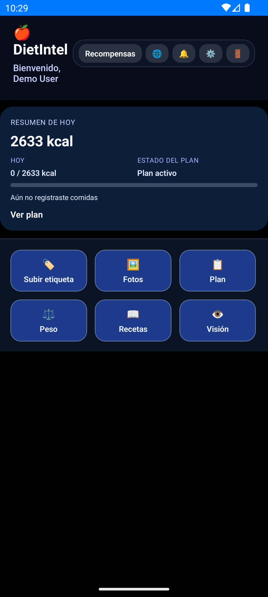
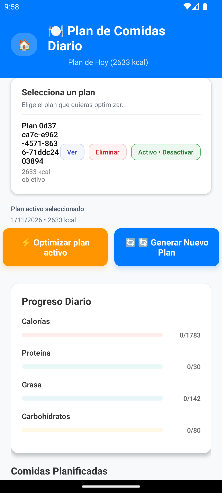
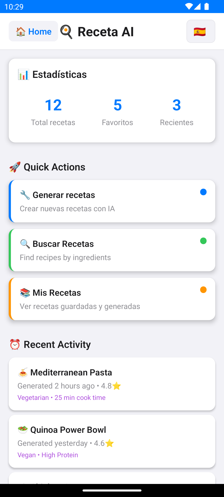

# DietIntel: The AI Revolution That's Transforming Fitness and Nutrition

For decades, fitness has operated on a one-size-fits-all model. Generic meal plans. Standard macros. Cookie-cutter advice. But personalization at scale was impossible—until now.

Meet DietIntel: an AI-powered nutrition platform that doesn't replace your dietitian; it amplifies their expertise. It's the 24/7 execution layer that keeps personalized nutrition strategies on track, adapting in real-time to your unique needs, goals, and lifestyle.

## The Problem Dietitians Face

A dietitian can craft the perfect plan, but they can't be there every time you eat. They can't adjust macros based on yesterday's workout. They can't suggest meal optimizations at 6 PM when you're deciding what to cook. They can't track patterns across thousands of users to understand what actually works for *your* body composition and goals.

DietIntel solves this. Your dietitian sets the strategy. DietIntel executes it, learns from it, and adapts it—24/7.

---

## Your Command Center: The DietIntel Dashboard

When you open DietIntel, you're looking at a unified command center for personalized nutrition. The interface is clean and purposeful: at the top, quick-access buttons for your different nutrition contexts. Below, a real-time summary showing:

- **Today's Calorie Summary**: 2633 kcal target displayed prominently, with your actual vs. planned breakdown
- **Active Plan Status**: What meal plan you're currently following
- **Progress Tracking**: Instant visibility into whether you're on track

But this is just the dashboard. The real power emerges when you dive into DietIntel's four AI systems. Notice the six action buttons:
- **Plan** (meal planning)
- **Scan barcode** (product lookup)
- **Photos** (Food Vision AI)
- **Weight** (body composition tracking)
- **Recipes** (AI Recipe Generator)
- **Vision** (AI meal analysis)

This is where nutrition intelligence happens.

---

## 1. Smart Diet AI Engine — Real-Time Personalization

Tap into the Smart Diet Engine and you're accessing a system powered by six simultaneous recommendation algorithms. Here's what's actually happening:

**The algorithm stack:**
- **Collaborative filtering** learns from patterns of thousands of users globally—understanding that people similar to you tend to respond well to specific foods and meal timing
- **Nutritional gap detection** identifies what micronutrients you're missing based on your eating history
- **Taste learning** remembers what you actually enjoy (not just what's healthy)
- **Metabolic personalization** adapts to *your* unique metabolism, not generic assumptions
- **Real-time optimization** suggests specific meal swaps before you get hungry at 6 PM

**What you see on screen:** Personalized recommendations with confidence scoring. Not generic "eat more vegetables"—but specific, actionable suggestions like "swap your afternoon snack for Greek yogurt to hit protein targets while staying under 300 calories."

**Response time:** Optimized to 2-7ms average with Redis caching hitting 90%+ cache rates. You ask the AI, and it answers instantly.

The result? A recommendation engine that feels like it was built just for you. Because it was.

---

## 2. Food Vision AI — One Photo, Complete Analysis

Instead of manually logging meals, you simply point your phone at your plate.

The Vision AI immediately:
- **Identifies ingredients with 85%+ accuracy** - It recognizes chicken, rice, broccoli, sauce—all components
- **Estimates portion sizes** using reference objects and visual plate coverage analysis
- **Calculates complete macronutrient breakdown** - Protein, carbs, fats, and micronutrients
- **Suggests compensatory exercises** if you want to offset calories consumed
- **Matches against 600k+ product database** for precise nutritional data

**No manual entry. No searching. Just one photo.**

The technology behind this: OpenCV-based food detection using HSV color space analysis. Heuristic algorithms for ingredient identification (expandable to deep learning as we scale). Confidence scoring so you know when the AI is certain vs. making educated guesses.

Your dietitian gets complete data. You get instant feedback. The system learns from your corrections over time.

---

## 3. Recipe AI Generator — The Game Changer

This is where DietIntel shifts from "nutrition tracker" to "complete nutrition intelligence platform."

Tell the Recipe AI Generator:
- Your fitness goal (building muscle? Cutting fat? Heart-healthy?)
- Dietary preferences (vegan? Mediterranean? No shellfish?)
- How much time you have to cook
- What ingredients are in your kitchen

**The AI generates recipes specifically optimized for your goals.**

Building muscle? It creates recipes heavy in protein with strategic carb timing around workouts. Want to lose weight? Meals that are calorie-conscious but actually taste good—not punishment food.

**The Recipe AI also:**
- Generates smart shopping lists consolidating ingredients across recipes
- Estimates total costs for ingredients
- Learns your taste preferences over time, getting better at recommendations
- Substitutes ingredients based on dietary restrictions or what you have available
- Calculates complete nutritional profiles for every recipe

Your dietitian sets macro targets. DietIntel generates recipes that hit those targets. You eat food you actually enjoy. Everyone wins.

---

## Why This Matters

**For competitive athletes:** Your coach handles training. Your dietitian sets macros. DietIntel optimizes recipes for your specific training cycle, generates meal timing around workouts, and adjusts as your body composition changes. You get meal plans that adapt to your periodization.

**For weight loss:** The AI identifies patterns your dietitian can review ("every Tuesday you eat heavier"). Instead of judgment, DietIntel auto-adapts your meal suggestions for the rest of the week while your dietitian addresses root causes (habit? stress? availability?).

**For people with dietary restrictions:** The ingredient substitution engine actively learns and applies your preferences to every recommendation. Allergies aren't just filters—they're integrated into the meal generation logic.

**For everyone working with a nutrition professional:** Finally, a tool that bridges the gap between expert planning and daily reality—a 24/7 assistant that keeps you accountable, suggests improvements, and learns what actually works for your unique situation.

---

## The Revolution in Professional Nutrition

DietIntel represents the future:

- **From static plans to adaptive protocols** — Your dietitian's strategy continuously applied and adjusted based on your daily response
- **From generic to precision-personalized** — AI algorithms understanding *your* unique metabolism, not averages
- **From sporadic feedback to constant guidance** — Real-time meal optimization instead of weekly check-ins
- **From data collection to data intelligence** — Understanding *why* your body responds, not just tracking what you ate
- **From siloed features to integrated system** — Food vision, recipe generation, meal planning, and analytics working as one intelligence layer

This isn't about replacing nutrition expertise. It's about amplifying it at scale.

The professional nutrition industry is entering a new era. The question isn't whether AI will transform fitness and nutrition—it already is. The question is whether you'll harness it.

---

## Open Source and Ready to Deploy

DietIntel is open source and available on GitHub. Whether you're a fitness professional looking to amplify your clients' results, a competitive athlete serious about nutrition optimization, or someone working with a dietitian to actually stick to your plan, DietIntel helps you achieve personalized nutrition at scale.

**GitHub Repository:** [https://github.com/krukmat/diet-intel](https://github.com/krukmat/diet-intel)

The future of nutrition isn't generic. It's intelligent. It's personal. It's adaptive.

It's DietIntel.

---

**Category:** AI / Fitness / Nutrition / Health Tech
**Tags:** #AI #Nutrition #FitnessTech #MachineLearning #Personalization #NutritionScience

---

*DietIntel is built to scale and amplify professional nutrition expertise, not replace it. Every feature described is functional and running on production infrastructure. This is the future of professional nutrition, available now.*
